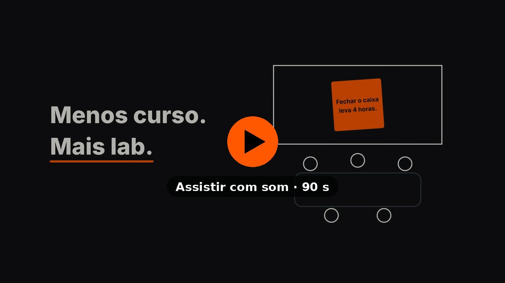

# R2S Lab

**R2S Lab — Reskilling too Skilling.** Menos curso. Mais lab.

> “Dá pra resolver isso com IA?” Em 12 semanas, a sua squad responde com número, custo e uma decisão do negócio.

Para a prática de Data & AI do Brazil Engineering HUB.

<video src="https://raw.githubusercontent.com/juliopessan/r2s-lab/main/docs/source-assets/R2S_Lab_teaser_90s_narrado_16x9.mp4" poster="docs/readme/teaser-play.jpg" controls playsinline width="100%"><a href="https://github.com/juliopessan/r2s-lab/blob/main/site/assets/teaser.mp4"></a></video>

O método em 90 segundos, com narração: [assistir com som](https://github.com/juliopessan/r2s-lab/blob/main/site/assets/teaser.mp4) · [baixar o MP4](https://raw.githubusercontent.com/juliopessan/r2s-lab/main/docs/source-assets/R2S_Lab_teaser_90s_narrado_16x9.mp4) · [ler a transcrição](site/assets/teaser.pt-BR.txt)

## Curso não muda papel. Caso real muda.

Trilha de vídeo termina em certificado. O R2S Lab termina em decisão: a sua squad pega um problema real de
um patrocinador, prova que o valor supera o custo, constrói a solução mais barata que funciona e leva o
resultado ao negócio. Quem está mudando de papel aprende fazendo; quem já domina o papel leva o caso até o
fim. Os dois no mesmo laboratório.

| 12 semanas | 7 etapas | 5 gates | 5 pessoas por squad | 6 horas protegidas por semana |
|:---:|:---:|:---:|:---:|:---:|

## Como funciona

A squad só avança quando prova o que o gate pede. Encerrar cedo também é um resultado: poupa a construção
do que não vale o que custa.

| # | Etapa | Gate |
|---|---|---|
| 1 | Intake | **G0** |
| 2 | Discover | |
| 3 | Frame Value | **G1** |
| 4 | Design | **G2** |
| 5 | Build | |
| 6 | Evaluate | **G3** |
| 7 | Pitch & Hand off | **G4** |

Os papéis giram a cada gate (Product Lead, Data Lead, AI Engineer, Eval & Risk Lead, Storyteller). No demo
day, dez minutos para pedir uma decisão ao negócio: **escalar**, **iterar** ou **encerrar**.

## Comece aqui

1. Crie o seu repositório **privado** a partir deste template. No GitHub, clique em *Use this template* → *Create a new repository*, escolha **Private** e use o nome `r2s-lab-<seu-usuario>`. O endereço do template é divulgado pela coordenação.
2. Clone o **seu** repositório (e não este template) na sua máquina.

   ```bash
   git clone <endereço do seu repositório privado>
   ```

3. Abra a pasta no VS Code.
4. Entre pela landing (`site/index.html`) ou direto pela R2S Academy (`academy/index.html`). A Academy mostra o caminho do lab nesta ordem: **pre-work → jornada da squad → pesquisa → certificado → painel**.
5. Faça o pre-work: cinco cursos na Academy, ou a página única `00-prework/index.html`. Ele leva um dia útil, e o seu andamento fica salvo no navegador.
6. Quando quiser registrar o andamento, clique em **Exportar progresso** (em *Sua jornada*), coloque o arquivo gerado em `progress/`, faça o commit e o push no seu repositório privado. Detalhes em `progress/README.md`.
7. No fim da turma, responda a pesquisa em `05-encerramento/pesquisa.html` e exporte de novo.

Nada do que você faz aqui é enviado a ninguém até você fazer o push: o seu progresso é privado e só a
coordenação o consolida no painel.

## R2S Academy

Catálogo de cursos no padrão da Claude Academy, em `academy/`: 5 cursos de pre-work (GenAI na prática, do
pedido ao problema, valor e custo, IA responsável e o case brief) e 6 cursos da jornada da squad, um por
etapa do Lab Loop. Cada curso concluído rende um selo; a coleção e o seu progresso ficam em *Sua jornada*.
Tema claro ou escuro pelo interruptor no topo: a escolha vale em todas as páginas do lab.

## A jornada da squad

Cada squad trabalha no seu próprio repositório (`r2s-lab-squad-<nome>`), copiado deste modelo.

- Preencha os documentos A–E em `squad/`. Cada campo pendente termina em `[preencher]`; pendência não é erro, mas o verificador mostra quantos faltam.
- Os gates G0 a G4 ficam em `squad/gates.json`. Quem aprova um gate é o coach (ou o patrocinador, no G0, G1 e G4): a mudança chega por pull request e o verificador barra o PR se o gate estiver aprovado com o dossiê incompleto.
- Rode `node tools/check-squad.mjs` antes de abrir o PR. Ele mostra o gate atual, o percentual de cada documento, o golden set e, quando há avaliação, a nota da squad e o nível de cada pessoa.
- A avaliação (`squad/assessment.json`) é preenchida pela coordenação e pelo coach, não pela squad.
- Ao cumprir os critérios do nível, a coordenação emite o certificado em `05-encerramento/certificado.html` (imprimir ou salvar em PDF; nada sai do navegador).

## Estrutura do repositório

```
r2s-lab/
├─ site/                 landing page com o teaser (cd site && npm run serve)
├─ academy/              R2S Academy: catálogo, cursos, lições, selos e Sua jornada
├─ 00-prework/           pre-work de 8 horas, em 5 partes
├─ 05-encerramento/      pesquisa de satisfação e certificado
├─ squad/                dossiê A–E, golden set, gates.json e assessment.json da sua squad
├─ tools/                check-squad.mjs e os geradores da Academy e dos selos
├─ progress/             seu progresso individual (arquivo exportado)
├─ admin/                painel da coordenação (cd admin && npm run demo); a lista do RH real nunca entra no git
├─ css/ · js/ · lib/     tema único, scripts das páginas e bibliotecas sem dependências
└─ docs/                 fontes do teaser e imagens deste README
```

Ainda por vir: `templates/` (A brief · B ADR · C pitch · D Social Impact Statement · E hearing) como pasta
própria e `starter-kits/` (RAG · agente · avaliação · custo por transação).

## Regras do lab

- **Prove o valor.** Nenhum caso entra sem patrocinador, métrica e baseline. No G1, o valor anual precisa superar 3× o custo anual de execução.
- **A técnica mais barata que funciona.** Regra ou SQL antes de ML, ML antes de LLM, uma chamada de LLM antes de um agente.
- **Meça.** O golden set vem antes do primeiro prompt, e cada solução reporta o custo por transação.
- **Sem dado de cliente.** Use dados sintéticos, públicos ou autorizados pelo responsável pelos dados.
- **Uma pessoa nomeada responde por cada decisão** tomada ou informada por um algoritmo. "O algoritmo fez" nunca é uma resposta aceitável.
- **O seu progresso individual é privado.** Ninguém além da coordenação vê o que está no seu repositório.

## Para quem mantém o lab

Tudo é HTML, CSS e JavaScript sem build: as páginas abrem direto do disco. Os testes usam o runner do
Node 22 e o Playwright.

```bash
npm test
```

```bash
cd site && npm test
```

```bash
cd admin && npm test
```
